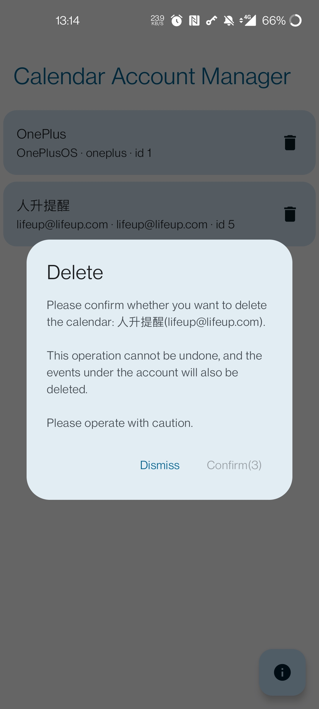

 

<h2 align="center">Calendar Account Manager</h2>

Help you delete unwanted calendar accounts.

  

  <a href="https://play.google.com/store/apps/details?id=fun.lifeupapp.calmanager">Google Play</a>
  ·
  <a href="https://github.com/Ayagikei/calendar-account-manager/releases/latest">GitHub Release (Play-signed APK)</a>

Install from **Google Play** when you can. The GitHub Release APK is the same Play App Signing build, for sideload only.

### What's it?

If a calendar account showed up and you cannot tell where it came from, this app is for you.

It lists every calendar account on the device and lets you delete the ones you do not want.

> Also a Compose practice project.

### Contribution

Pull requests are welcome. Follow the existing commit message style; there are no other special requirements.

### Release Log

**Version 1.4**

1. Target Android 16 (API 36)
2. Raise minSdk to 23
3. GitHub Actions upload to Google Play

**Version 1.2**

1. Introduce the compose Material You theme
2. 3 build-in themes
3. Add Splash Screen
4. Add rate us snack bar after deletion

**Version 1.1**

Fix UI issues in night mode —— Thanks to @somilror200

**Version 1.0**

First Release

- Green Material You theme color switch
- Improve splash animation
